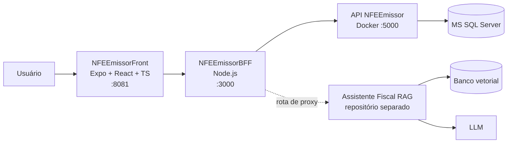

# NFEEmissorProject

Plataforma para **emissão e consulta de Nota Fiscal Eletrônica (NFe)** voltada a pequenos negócios e contadores, com foco em uso simples e manuseio seguro de certificados digitais.

O repositório reúne o aplicativo (Front) e o BFF (Backend for Frontend). Um **assistente fiscal com IA (RAG)** está sendo desenvolvido em um repositório separado e será integrado a este projeto.

> **Status:** em desenvolvimento. O Front possui as telas principais; o BFF e a integração com o assistente estão em construção.

## Visão geral

| Módulo | Pasta | Descrição |
|--------|-------|-----------|
| Front | [`NFEEmissorFront`](./NFEEmissorFront) | Interface em Expo + React (TypeScript) para emitir, consultar e acompanhar NFe e gerenciar certificados |
| BFF | [`NFEEmissorBFF`](./NFEEmissorBFF) | Camada intermediária em Node.js entre o Front e a API de NFe: autenticação, dados dos clientes, certificados e roteamento |
| API NFEEmissor | _[pasta ou repositório da API]_ | API de NFe executada em container Docker (Swagger em `localhost:5000`), com banco MS SQL Server |
| Assistente fiscal (RAG) | [Repositório separado](https://github.com/igormcr/Assistente-Fiscal-de-NFe--RAG----Integra--o-com-o-NFEEmissorFront) | Assistente com IA que explica rejeições da SEFAZ e tira dúvidas de preenchimento, citando a documentação oficial |

## Arquitetura



**Decisões de projeto:**
- O Front não fala diretamente com a API de NFe nem guarda certificados de terceiros: isso passa pelo BFF.
- O assistente de IA é um serviço separado, acessado apenas pelo BFF, que mascara dados sensíveis (CNPJ, CPF, nomes) antes de qualquer chamada.
- Certificados digitais e chaves privadas **nunca** são enviados a serviços de IA.

## Funcionalidades

**Já disponíveis (Front):**
- Emissão de NFe por integração com API externa
- Consulta de status e histórico de notas
- Gerenciamento de certificado
- Interface responsiva com suporte web

**Em desenvolvimento:**
- BFF com autenticação, cadastro de clientes e armazenamento seguro de certificados
- Migração do Front para consumir o BFF
- Assistente fiscal com IA: explicar rejeições, analisar XML e tirar dúvidas, sempre com citação da fonte

## Como rodar

### Pré-requisitos
- Docker (para a API NFEEmissor e o MS SQL Server)
- Node.js 18+ e npm ou yarn
- (Opcional) Expo CLI para testes em dispositivos móveis

### Subindo o ambiente (nesta ordem)

**1. API NFEEmissor + MS SQL Server (Docker)**

Suba os containers da API e do banco. Quando estiver no ar, o Swagger fica em:

http://localhost:5000/swagger/index.html

**2. BFF**

```bash
cd NFEEmissorBFF
npm install
npm run dev
```

Disponível em http://localhost:3000

**3. Front**

```bash
cd NFEEmissorFront
npm install
npm run web
```

Disponível em http://localhost:8081

| Serviço | Comando | URL |
|---------|---------|-----|
| API NFEEmissor + SQL Server | Docker | http://localhost:5000/swagger/index.html |
| BFF | `npm run dev` | http://localhost:3000 |
| Front | `npm run web` | http://localhost:8081 |

### Variáveis de ambiente

Copie os arquivos de exemplo (`.env.example`) de cada módulo e preencha com seus valores. **Nunca** versione chaves, senhas ou certificados.

## Estrutura do repositório

```
NFEEmissorProject/
├── NFEEmissorFront/   # App Expo + React (TypeScript)
│   └── src/
│       ├── app/          # telas: emitir, consultar, status, certificado
│       ├── components/   # componentes reutilizáveis
│       ├── lib/          # client da API e helpers de certificado
│       ├── constants/ hooks/ types/
├── NFEEmissorBFF/     # Backend for Frontend (Node.js)
└── README.md
```

## Roadmap

- [x] Telas principais do Front (emitir, consultar, status, certificado)
- [x] Monorepo com Front e BFF
- [ ] BFF: contrato da API (OpenAPI) e integração com a API NFEEmissor
- [ ] BFF: certificados criptografados e autenticação
- [ ] BFF: endpoints de emissão, consulta e status
- [ ] Front: consumir o BFF, login e cadastro de clientes
- [ ] Integração com o assistente fiscal (explicar erro, analisar XML, chat com citações)
- [ ] Testes, CI/CD e deploy no Azure

## Segurança e privacidade

- Certificados digitais são tratados como dados críticos: armazenamento criptografado e acesso restrito.
- Dados de clientes não devem ser usados em testes, demos ou capturas de tela; use dados fictícios ou ambiente de homologação.
- Respostas do assistente de IA são **apoio informativo** e não substituem a validação de um contador.

## Contribuição

Sugestões e issues são bem-vindas. Antes de abrir um PR, rode os testes e siga os tipos definidos em `src/types/` para os formatos de payload.

## Autor

**Igor Marinho Carneiro Rodrigues** — Desenvolvedor Full-Stack  
GitHub: [@igormcr](https://github.com/igormcr)

## Licença

Consulte o arquivo `LICENSE` do repositório. _[adicionar a licença escolhida, caso ainda não exista]_
